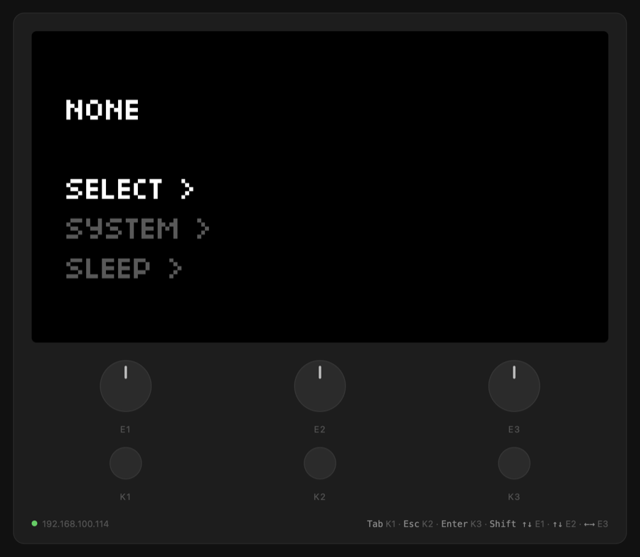

# norns-remote

The [monome norns](https://monome.org/docs/norns/) screen in any browser, with its
keys and knobs, the way [m8c](https://github.com/laamaa/m8c) works for the
Dirtywave M8: the norns sends what is on its screen as data, not video, and the
page draws it.



- **Pixel-exact:** the screen is 128×64 pixels in 16 levels, and the page draws
  exactly those pixels at any size. Nothing is encoded as video, so nothing blurs
  or stutters.
- **Light:** the norns sends a frame only when the screen changes (plus one a
  second), about 300 bytes once compressed. With no browser connected, it sends
  nothing.
- **Everything shows:** scripts, the system menus, and the screen with no script
  loaded.
- **Any device:** a Mac, PC, tablet or phone on the same network. Nothing to
  install besides the mod; the relay uses only Python's standard library, which
  every norns has.

## Install

In maiden's REPL:

```
;install https://github.com/mchibouni/norns-remote
```

Then on the norns, enable the mod: go to SYSTEM > MODS, select NORNS-REMOTE, and
turn E3 until a `+` shows. Then go to SYSTEM > RESTART.

Open `http://norns.local:8099/` in a browser, or the norns' IP address instead of
`norns.local`. On a Mac, Chrome can open it as an app window of its own:

```sh
open -na "Google Chrome" --args --app=http://norns.local:8099/
```

## Controls

| norns | keyboard | mouse or touch |
| --- | --- | --- |
| K1 | Tab or 1 | click K1 |
| K2 | Esc, Backspace or 2 | click K2 |
| K3 | Enter or 3 | click K3 |
| E1 | Shift+Up/Down, Page Up/Down | drag or scroll on E1 |
| E2 | Up/Down | drag or scroll on E2 |
| E3 | Left/Right | drag or scroll on E3 |

Keys follow the press and the release, so holding K1 works as on the device. The
keyboard map uses key positions, so it is the same on any keyboard layout. One knob
step is one step on the norns: the norns needs several encoder ticks per step
(8 for E1 in the menus), and the mod sends as many as the current setting needs.

## How it works

- `lib/mod.lua`, the mod: starts the relay. While the relay says a browser is
  connected, it reads the screen 30 times a second with `screen.peek`, and sends
  it over OSC (one letter per pixel) when it changed. It also turns knob steps
  from the relay into encoder ticks.
- `relay.py`: serves the page and a websocket on port 8099. It sends each screen to
  the browsers as 8192 levels, zlib-compressed, and passes keys to matron's
  `/remote/key` OSC command and knob steps to the mod.
- `index.html`: the page.

Anyone on your network can open the page and control the norns, as they can
already with maiden. The relay listens on port 8099; the mod and the relay talk on
port 10112, on the norns only.

## Uninstall

Disable the mod in SYSTEM > MODS, then SYSTEM > RESTART. Delete
`dust/code/norns-remote` to remove it.
